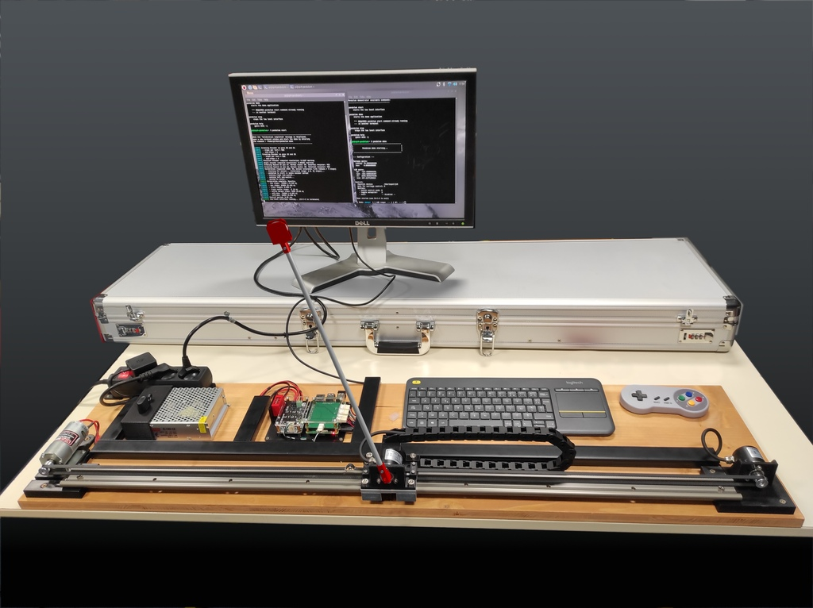
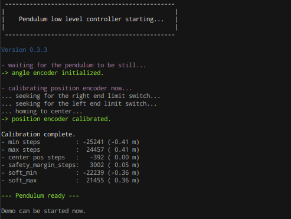
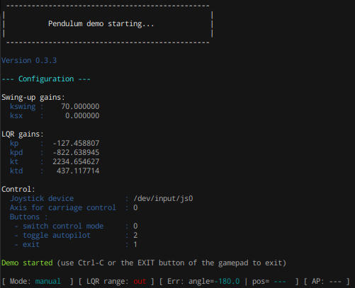

# Projet `pendulum-core`



Support logiciel du démonstrateur "Pendule Inversé".

Il se décompose en deux parties :

- la couche bas niveau, assurant deux rôles principaux :
    - interfaçage avec le hardware à l'aide de la librairie `pigpio`
    - conditionnement par filtrage des signaux des encodeurs de position et
      d'angle
- l'application de démonstration, permettant d'interagir avec le pendule :
    - en contrôle 100% manuel
    - en activant l'asservissement LQR maintenant l'équilibre instable lorsque
      le pendule est au voisinage de la position
    - en activant le contrôle 100% automatique, qui amène dans un premier temps
      le pendule au voisinage de l'équilibre, puis passe en mode stabilisation
      automatique LQR lorsque les conditions nécessaires sont remplies.

Les communications entre les deux couches sont assurées par [**ZeroMQ**](https://zeromq.org/).

## Exécution

### `low_level_interface`

Cet exécutable gère les interactions bas niveau avec le matériel. Il doit donc
être en cours d'exécution pour que l'application `demo` puisse être démarrée.
Le plus simple est par conséquent de le lancer en *background*.

**Attention :** il nécessite de s'exécuter en *root*. Un message d'erreur le signale
au démarrage si ce n'est pas le cas.

Le binaire prend en paramètre le path vers le fichier de configuration du pendule,
concernant les aspects matériels (identification et configuration des GPIO par exemple)
ainsi que le paramétrage des filtres appliqués aux mesures et des lois de contrôle
utilisées dans ses différents modes.

```
$ sudo /path/to/low_level_interface /path/to/pendulum_pi_config.yaml &
```

Exemple de sortie console :



### `demo`

C'est l'application end-user permettant d'interagir avec le pendule dans ses
différents modes et de le contrôler à l'aide du gamepad.

Elle est exécuté en tant que user standard.

Le binaire prend en paramètre le path vers le fichier de configuration de la
démonstration elle-même (pas celui du pendule).

```
$ /path/to/demo /path/to/demo.yaml
```

Exemple de sortie console :



## Crédits

Ce projet est basé sur les travaux menés par Franco FUSCO dans le cadre de
la préparation de sa thèse. Le repository original est disponible
[ici](https://github.com/francofusco/pendule_pi).
